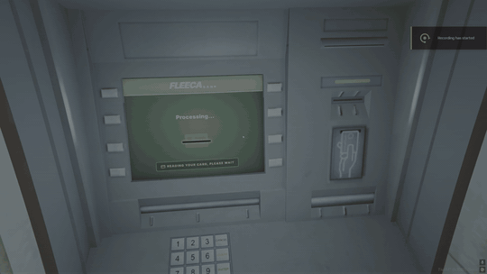

# atmdui for WHIP

A realistic ATM for the [WHIP](https://whipfx.net) FiveM framework. The banking screen is drawn on the ATM's own
screen in the world (a DUI), and the camera moves to the keypad: you press the real buttons on the machine.



This is a port of **[osm-atmdui](https://github.com/OsmFX-Mods/osm-atmdui)** by [osmfxmods.com](https://osmfxmods.com)
to WHIP. All credit for the original design, the screen and the camera work goes to OsmFX Mods. The original's own
readme is kept as [ORIGINAL_README.md](ORIGINAL_README.md).

## Licence

[CC BY-NC-SA 4.0](LICENSE.md), the same as the original: keep the credit, share changes under the same licence, and
do not sell it.

## What it does on WHIP

- **Cards are tied to WHIP bank accounts.** A card belongs to one account (the player's default account when the card
  is issued). Withdraw, deposit and transfer go through WHIP's bank (`BankWithdraw`, `BankDeposit`, `BankTransfer`).
  The bank's own rules apply: permissions on shared accounts, frozen accounts, and every move on the statement.
- **Cash is WHIP's cash item.** Withdrawals pay with `PayPlayer`. Deposits charge with `ChargePlayer` and refund if the
  bank refuses.
- **PINs stay on the server.** A PIN is never written on the card item, since item metadata is visible to the
  holder's game. It is hashed (`GetPasswordHash`) in the `atmdui_cards` table. Wrong tries and lockouts are counted on
  the server and survive a relog. Nobody can read a PIN, admins included: a forgotten PIN means a new card.
- **Transfers go to WHIP account numbers.** On the keypad, type the digits of a `WB-######` number.
- **Every request is checked.** All calls are `SecureCallback`s with rate limits and checked parameters. A correct
  PIN opens a session on the server for that card.
- **One WHIP prompt** (`AddAction`) on every ATM model. No target resource is needed.
- **The screen is handled by WHIP** (`SetScreenOpen`) while the camera is at the keypad and while a receipt is open.
- **Settings in game:** money and PIN settings are also on `/whip` → Settings → ATM.
- **Items:** `atmdui_card` (Bank Card) and `atmdui_receipt` (ATM Receipt) are registered by the resource, with their
  pictures in `html/img/items/`. The receipt shows its details in the inventory and opens when used.
- **Your own body stays out of the view** while the camera is at the keypad. Other players still see you standing at
  the ATM.

## Install

The full step-by-step guide, with settings and troubleshooting, is in **[SETUP.md](SETUP.md)**. In short:

1. Requires `whip_core` 1.0 or newer and `oxmysql`.
2. Put the folder in your resources **named `atmdui`** (the ZIP unpacks as `whip-atmdui-main`: rename it), and add `ensure atmdui` after WHIP's lines in `server.cfg`.
3. Turn off WHIP's own ATM prompt on the same props, or both prompts show. In `whip_core/config.lua`, set
   `Config.AtmProps = {}`.
4. Start the server. The `atmdui_cards` table is created by itself; there is no SQL to import.

## Configuration

`config.lua` holds the ATM models, the screen and camera placement, the button positions per model, the PIN rules
(`Config.PIN`: length, tries, lockout, card cost) and the quick amounts. The money and PIN settings can also be changed
in game on `/whip` → Settings → ATM.

The screen page is built from `web/` (React + Vite + Tailwind) into `html/index.html`. To change it:

```bash
cd web
npm install
npm run build
```

## Changes from the original

| Original (QBCore / ESX / Qbox + ox_lib) | On WHIP |
|---|---|
| Framework bridges (`bridge/`, `client/bridge.lua`, `server/bridge.lua`) | Removed: WHIP's exports are used directly |
| One "bank" balance per player | A card belongs to one WHIP bank account |
| Cash as a number | WHIP's cash item |
| PIN stored in the card's metadata | Hashed on the server, never on the card |
| Transfer by citizenid | Transfer by WHIP account number |
| `lib.callback` | `SecureCallback` with rate limits and checked parameters |
| ox_target / qb-target / a proximity loop | One `AddAction` prompt on every ATM model |
| `hud:client:ToggleHUD` | `SetScreenOpen` |
| Networked cash and card props | Local props (visual only) |
| config.lua only | Also a `/whip` → Settings → ATM page |
| `bank_card` / `atm_receipt` in the framework's item list | `atmdui_card` / `atmdui_receipt` registered by the resource |
| An anti-cheat agent line in the manifest | Removed |
